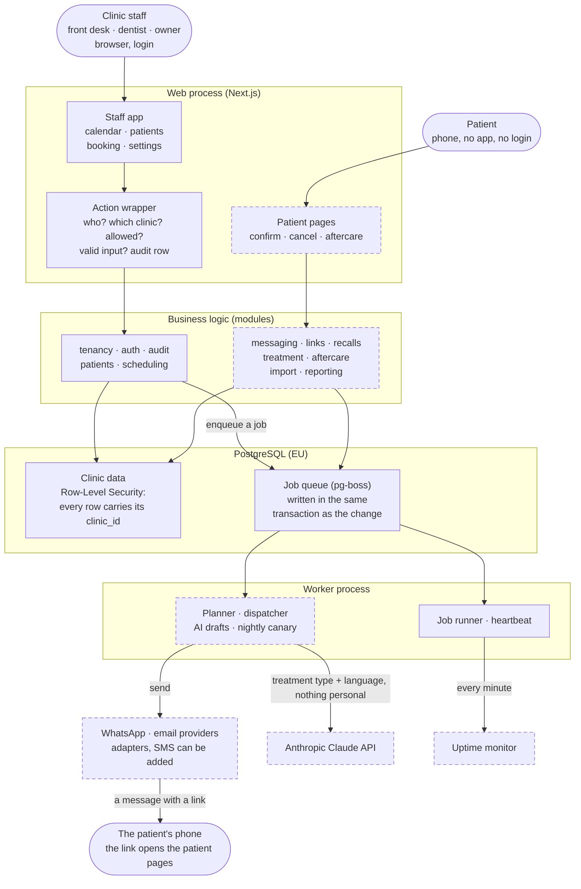
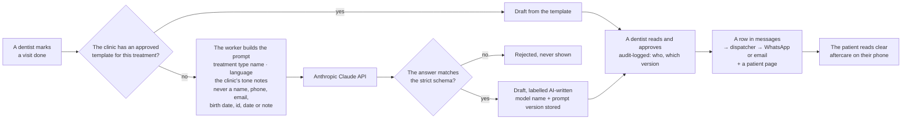
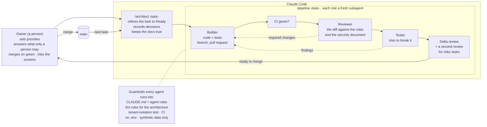

# Chairside

Scheduling for small dental clinics, with automatic patient reminders. What and why:
`docs/intent.md`. How it is built: `docs/architecture/overview.md`.

## How it fits together

The map for someone new to the project: one codebase, two running processes, one database. A
**dashed box** in the diagrams is designed and documented but not built yet (October 2026); the
other components run today. The detail behind each box: `docs/architecture/overview.md`.

### The system



- **Clinic staff** sign in with a browser. The front desk books and moves appointments; a dentist
  sees their own day; the owner sees the results and controls who may do what. There is no patient
  app: a **patient** gets a message with a link, and the link opens a simple page on their phone.
- **The web process** (Next.js, React) renders the pages and is deliberately thin: a page parses
  the input, calls a module and renders the answer. Every change goes through the **action
  wrapper**, which asks the same questions each time (who is signed in, which clinic, is this role
  allowed, is the input valid) and writes an audit row. The same process will serve the patient
  pages a link opens, and the webhooks the providers call to report delivery. `src/app/`.
- **The modules** hold all business logic as plain TypeScript, with no web framework in them, so
  the worker and the tests run the same code as the pages. Each module owns its tables; other
  modules call its functions and never query its tables. A lint rule enforces that. `src/modules/`.
- **PostgreSQL** holds everything, the job queue included, so there is no second system to run.
  Every table has a `clinic_id` and Row-Level Security: the database itself refuses to show one
  clinic another clinic's rows, even if the code forgot a filter. A test fails the build for any
  table without it.
- **The worker** does the slow and timed work. It will plan which message goes to whom and when,
  send it, draft aftercare text and run the nightly check that every appointment tomorrow has its
  reminder. Today it runs the queue and a heartbeat. If it is down, jobs wait in the database;
  nothing is lost. It is the only process that talks to outside services. `src/worker/`.
- **Outside services** sit behind adapters: WhatsApp and email (fake ones in development and
  tests, real ones from milestone M3), the Claude API for aftercare drafts (M6), and an uptime
  monitor that notices when the heartbeat stops.

**What a clinic gets out of it:** reminders go out by themselves and a patient confirms or cancels
in two taps, so fewer chairs stand empty; overdue patients are called back by recalls; patients get
written aftercare after treatment; and the front desk stops chasing people by phone. The app shows
the numbers, so the clinic can see that it works.

**Where it stands (October 2026):** built and merged are login and clinics with roles, the audit
log, the patient list and new patient, the calendar day view and booking, opening hours and closed
days, the worker's queue and heartbeat, the Docker image with its health check, and CI with
end-to-end journeys (milestones M0 and M1 on `docs/product/roadmap.md`). Next come the rest of
the schedule screens, the staging deployment and the reminder loop (M2). The board:
`docs/progress/board.md`.

### Where AI is used in the product

The AI writes a first draft of aftercare instructions ("after a filling, avoid hot drinks
until…") when the clinic has no approved template for that treatment. This is milestone M6, so
the flow below is the design, not yet code. The rules for it are already fixed in
`docs/architecture/security-privacy.md`.



- **What goes in:** the treatment type's name, the language and the clinic's tone notes. Nothing
  that identifies a patient reaches the model: no name, contact detail, birth date, id, appointment
  date or note. The call is made only from the worker, through one prompt builder, so the boundary
  is checked in one place.
- **What comes back** is treated as untrusted text: it must match a strict schema or it is thrown
  away, it is labelled as AI-written, and nothing reaches a patient until a dentist approves it.
  The approval is audit-logged with the model name and the prompt version.
- **Then it is an ordinary message:** a row in `messages`, sent by the dispatcher like a reminder,
  with the same quiet hours, the same cost caps and the same delivery tracking. No code anywhere
  sends a message any other way.
- **It is tested with evals, not exact matches:** about 25 treatment types per language, with checks
  written as plain code (valid schema, allowed placeholders only, the right language, length
  limits), run before a prompt or model change ships. `docs/process/test-strategy.md`.

### How AI builds it

Chairside is built by one person directing AI agents in Claude Code. The agents write the code and
the tests; the process around them is designed so that a wrong guess cannot slip through unseen.



- **The owner** (a person) decides what only a person should: scope, money, legal questions, and
  anything that touches patient data, login, or what the AI receives. An agent that meets such a
  choice stops and asks instead of guessing (`docs/process/agent-rules.md`, rule 4). The owner
  merges every pull request, only on green CI, and tries each new screen by hand.
- **The architect** turns a backlog item into a task with acceptance criteria a tester can check,
  and records every decision with its reason in `docs/log/decisions.md`. `/architect <task-id>`.
- **The pipeline** runs one task through builder, reviewer and tester, each as a fresh subagent
  with none of the others' context, so the reviewer does not inherit the builder's blind spots.
  They talk only through the task's handoff note in `docs/progress/handoffs/`, the board and the
  branch. A finding goes back to a builder; after two fix rounds the pipeline stops and asks the
  owner. A risky task (migrations, login, tenant isolation, message sending, the AI prompt) gets a
  second, independent review. `/pipeline <task-id>`, `docs/process/workflow.md`.
- **The guardrails** are code, not goodwill: `CLAUDE.md` and the agent rules that every session
  loads first; custom lint rules that fail on a crossed module boundary, a database call outside
  the tenant wrapper or a form that could leak its fields into a URL; a test that fails any table
  without Row-Level Security; CI on every pull request; and a settings file that stops agents from
  reading `.env`. All data outside production is synthetic.

What that process has produced between 2 and 20 October 2026:

| What | Count |
|---|---|
| Merged pull requests | 69 |
| Task handoff notes (`docs/progress/handoffs/`) | 41 |
| Recorded decisions (`docs/log/decisions.md`) | 115 |
| Unit test files | 74 |
| Integration test files, against a real PostgreSQL | 47 |
| Browser journeys, in Chromium, Firefox and WebKit | 8 |

## What you need

- **Node.js 24** (LTS): https://nodejs.org. Check with `node --version`.
- **pnpm**: `npm install -g pnpm`. The project pins its exact version in `package.json` and
  pnpm switches to it by itself.
- **Docker Desktop**, running: https://www.docker.com/products/docker-desktop. It runs the local
  PostgreSQL database, and builds the app's image (`docs/runbook.md`).
- **Git**.
- **GitHub CLI** (`gh`), logged in with `gh auth login`: agents use it to open pull requests.
  On Windows: `winget install GitHub.cli`.
- **The test browsers**, for `pnpm test:e2e` only, once after `pnpm install` (step 2) and again
  after a Playwright upgrade: `pnpm exec playwright install chromium firefox webkit` (about 500 MB).

The commands below work in PowerShell, Command Prompt and macOS or Linux terminals. The one
command that differs is copying the settings file (step 3).

## Run it locally, from zero

1. Get the code and go into the folder:
   ```
   git clone <repository-url> chairside
   cd chairside
   ```
2. Install the dependencies:
   ```
   pnpm install
   ```
3. Create your local settings file from the template:
   ```
   Copy-Item .env.example .env      # PowerShell
   copy .env.example .env           # Command Prompt
   cp .env.example .env             # macOS or Linux
   ```
   The values in it only work with the local database and are fine as they are. Its last line,
   `NEXT_TELEMETRY_DISABLED=1`, stops Next.js from sending anonymous usage data; if your `.env` is
   older than that line, copy it over from `.env.example`.
4. Start the database and wait until it is ready:
   ```
   docker compose up -d --wait
   ```
   It listens on port 5433 of this machine, so it does not clash with a PostgreSQL you may
   already have on 5432.
5. Build the database from the migrations and fill it with the seed: two invented clinics, a
   login for every role and a working week of appointments (next two sections):
   ```
   pnpm db:reset
   ```
6. Start the app:
   ```
   pnpm dev
   ```
   Open http://localhost:3000. You see the login page. Sign in with one of the seeded logins.

## Seeded logins

`pnpm db:reset` (or `pnpm db:seed` on its own) makes these logins. Every one of them has the same
development password: **`local-staff-password`**.

| Who | Email | Clinics |
|---|---|---|
| Owner | `owner@example.test` | Harbour Street Dental and Забна клиника Сончоглед: sees Switch clinic |
| Dentist | `dentist@example.test` | Harbour Street Dental |
| Hygienist | `hygienist@example.test` | Harbour Street Dental |
| Front desk | `front-desk@example.test` | Harbour Street Dental |
| Front desk who may import patients | `front-desk-import@example.test` | Harbour Street Dental |
| Front desk of the second clinic | `front-desk-soncogled@example.test` | Забна клиника Сончоглед only |

Everything the seed writes is invented: names from fixed lists, phones from one made-up block of
`+389` numbers, emails at `example.test` (`src/db/seed/fake-data.ts`). The seed refuses every
database that is not on this machine, and `NODE_ENV=production`, so these logins exist only here.
In notes and tasks, name a seeded login by its role ("the seeded front desk"), not by its email.

## The seeded week

Harbour Street Dental runs a working week (`src/db/seed/02-scheduling.ts`):

- Three providers, each a calendar column with a chair, a colour and a lunch break every weekday:
  two dentists and a hygienist. The seeded dentist and hygienist are linked to their columns; the
  owner is not.
- Open Monday to Friday, 08:00 to 18:00, and closed on the Monday after the week.
- Ten treatment types with their lengths.
- 40 patients, named in Latin and in Cyrillic letters: three without a phone, a child whose phone
  and email are their guardian's, two siblings who share their guardian's phone, one archived.
- 76 appointments, Monday to Friday of this week, or of next week when the seed runs on a Saturday
  or a Sunday. Days before today are over (completed, no-show or cancelled); today's morning is over
  or in the chair, its afternoon still to come; later days are booked, confirmed or cancelled. One
  visit is booked over another ("book anyway").

Забна клиника Сончоглед has the same hours, one dentist, five patients and ten appointments, and
no treatment types.

The week is made for the day the seed runs, in the clinics' time zone (`Europe/Skopje`). On a
database that already holds the seed, `pnpm db:seed` adds nothing and the week stays where it was:
run `pnpm db:reset` to move it to the current week.

## Everyday commands

| Command | What it does |
|---|---|
| `pnpm dev` | Runs the app with live reload. |
| `pnpm check` | Runs every check a change must pass: formatting, lint, types, unit tests and database tests. The database must be running. |
| `pnpm test` | Unit tests only (fast, no database). |
| `pnpm test:integration` | Tests against the real database. They use their own database (`chairside_test`), so your local data is not touched. |
| `pnpm test:e2e` | The end-to-end journeys in Chromium, Firefox and WebKit. Run `pnpm build` first and stop `pnpm dev`. They use their own database (`chairside_e2e`). |
| `pnpm db:reset` | Deletes the local database, builds it again from the migrations and fills it with the seed. |
| `pnpm db:seed` | Adds the seed to the local database. A second run adds nothing. |
| `pnpm clinic:create --name … --owner-email … --owner-name …` | Creates a clinic and its first owner, and prints the one-time link where the owner chooses their password. `docs/runbook.md` says how. |
| `pnpm worker` | Runs the worker: the job queue and a heartbeat line once a minute. Ctrl+C stops it. `docs/runbook.md` lists its log lines. |
| `pnpm format` | Fixes code formatting. |
| `docker compose stop` | Stops the database. Your data stays until the next `db:reset`. |

## Two checkouts on one machine

Two copies of the repository can work side by side, for two tasks at once, when the second one
gets its own database container and its own ports. Nothing else is shared: `pnpm install` and
`pnpm build` are per folder, the Playwright browsers are installed once for the machine.

1. Clone the repository again, into another folder (or `git pull` in a clone you already have).
2. Copy the first checkout's `.env` into it, then edit the copy:
   - in the three database URLs, replace `5433` with `5434` (all three must name the same port);
   - add, without the leading `# `, the four lines at the end of `.env.example`:
     `COMPOSE_PROJECT_NAME=chairside-b`, `DB_PORT=5434`, `E2E_APP_PORT=3200`, `E2E_DEV_PORT=3201`.
3. In the second folder: `pnpm install`, `docker compose up -d --wait`, `pnpm db:reset`.

`docker compose` reads that folder's `.env`, so the second checkout gets a container called
`chairside-b-db-1` on port 5434 with a data volume of its own, and its `pnpm test:e2e` runs on
ports 3200 and 3201. The first checkout changes nothing and keeps `chairside`, 5433, 3100 and 3101.

Only one `pnpm dev` runs at a time: both checkouts use port 3000, and login trusts only the address
in `BETTER_AUTH_URL`. Each checkout's `docker compose stop` stops only its own container.

## If something goes wrong

- **`POSTGRES_PASSWORD` is missing** when starting Docker: step 3 was skipped. Create `.env`.
- **`... is not set`** from a `pnpm` command: `.env` is missing or incomplete. Compare it with
  `.env.example`.
- **`BETTER_AUTH_SECRET is not set`** (or `BETTER_AUTH_URL`): your `.env` is older than the login
  feature. Copy the two `BETTER_AUTH_` lines from `.env.example` into it.
- **`pnpm typecheck` fails on a page file that no longer exists:** old generated types in
  `.next/`. Delete the `.next` folder and run it again.
- **`pnpm dev` answers "not found" for a page that exists:** Next.js sometimes starts that way on
  Windows. Save the page's file (no change needed), or stop and start `pnpm dev` again.
- **Cannot connect to the database:** start Docker Desktop, then `docker compose up -d --wait`.
- **Port 5433 is already in use:** another program uses it. Stop that program, or set `DB_PORT` in
  `.env` to a free port and use that port in the three database URLs there too.

## Working on this project

Read `CLAUDE.md` first: the start-of-session ritual, the rules that are never broken, and the
technical conventions. Tasks and their status: `docs/backlog/` and `docs/progress/board.md`.

GitHub checks every pull request and every push to `main` (`.github/workflows/ci.yml`); merge
only when its run is green. What it runs, and how to run each step yourself: `CLAUDE.md`, "CI".

To run one task through builder, reviewer and tester in a single Claude Code session, type
`/pipeline <task-id>`, for example `/pipeline E00-T03`. How it works and when it stops for you:
`docs/process/workflow.md`.
